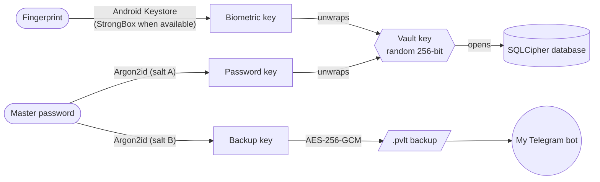

<p align="center">
  
</p>

<p align="center">
  
  
  
  
  
  <a href="https://github.com/Srihari-Prasath/My-Personal-PASS-Vault/releases/latest"></a>
  <a href="https://github.com/Srihari-Prasath/My-Personal-PASS-Vault/actions/workflows/ci.yml"></a>
  <a href="LICENSE"></a>
</p>

<p align="center">
  <a href="https://github.com/Srihari-Prasath/My-Personal-PASS-Vault/releases/latest">
    
  </a>
</p>

<p align="center">
  <b>A personal password vault for Android that keeps everything encrypted on my phone<br/>
  and backs it up — still encrypted — to my own Telegram bot.</b>
</p>

---

## Why I built this

I kept forgetting passwords — and, worse, the **recovery codes** that are supposed to save you when you forget them.
I didn't want to hand everything to another cloud account, so I built my own vault:

- Every password, recovery code, 2FA key, card and Wi-Fi password lives **encrypted on my phone**.
- **One master password** opens it. Fingerprint is a shortcut, never a replacement.
- If I lose the phone, an **encrypted backup** is waiting in my own Telegram bot. A new phone needs only the bot and my master password.
- When I change a password, the old one is **never lost** — every entry keeps its full password history.

---

## ✨ Highlights

| | |
|---|---|
| 🔐 **Local-first encryption** | SQLCipher database, Argon2id key derivation, AES-256-GCM, hardware-backed Android Keystore |
| 🕓 **Full password history** | Every change is kept with the dates it was in use. Restore any old password in one tap |
| 🖼️ **Real icons** | Logins show the actual app icon from my phone, or the website's own icon |
| ✈️ **Telegram backups** | Encrypted `.pvlt` file sent to my own bot automatically after every change; newest one pinned |
| 🔢 **2FA codes** | Built-in authenticator (TOTP), scan the setup QR with the camera or from a screenshot |
| 🧾 **Recovery codes** | Tick codes off as I use them; warning when I'm running low |
| 💳 **Cards & 📶 Wi-Fi** | Flip-card view with CVV on the back · share Wi-Fi with a QR code |
| 🛡️ **Security check** | Weak / reused / old passwords, expiring cards, optional breach check (k-anonymity) |
| 🔄 **Sync from Google** | Import from Google Password Manager — new logins added, changed passwords updated |
| 🧾 **Emergency kit** | Printable recovery sheet: restore steps, recovery codes, a box to hand-write the master password |
| 👆 **Confirm to reveal** | Optional fingerprint/PIN before showing or copying any secret |
| 🎭 **Decoy vault** | A second password opens a harmless fake vault if someone forces me to unlock |
| 🔔 **Reminders** | Local notifications if backups stop or I haven't typed the master password in a while |
| 🎞️ **Smooth UI** | Spring animations, shared-element transitions, swipe actions, predictive back |

---

## 🔁 How it works

<p align="center">
  
</p>

1. Everything is **encrypted on the phone** before it is stored or sent anywhere.
2. After each change, the app builds an **encrypted backup** and uploads it to **my own Telegram bot** a minute later (when online). The newest backup is pinned in the chat.
3. On a new phone: install PassVault → *"I have a backup"* → connect the same bot → type the master password → the whole vault (with history) comes back.

Telegram — and anyone who gets into the bot — only ever sees a scrambled file.

---

## 🧱 Security model



- The **vault key** is random and never stored in plain form — only wrapped by the password key and by a fingerprint-bound Keystore key.
- The **backup key** is derived separately, so a backup opens on any phone with just the master password.
- The `.pvlt` header (salt + KDF parameters) is authenticated, so a tampered file is rejected — never half-restored.

| Threat | Covered | How |
|---|:---:|---|
| Phone lost or stolen | ✅ | Encrypted at rest, auto-lock, keys in Keystore |
| Someone picks up my unlocked phone | ✅ | App's own lock, auto-lock, optional confirm-to-reveal |
| Telegram account or bot token leaked | ✅ | Backups are encrypted with my master password |
| Screenshots / screen recording / Recents preview | ✅ | `FLAG_SECURE` on every screen |
| Clipboard snooping | ✅ | Marked sensitive, auto-cleared after 30 s |
| Google cloud backup copying the database | ✅ | `allowBackup=false` + data-extraction rules |
| Phishing through autofill | ✅ | Apps matched by package, websites only from real browsers |
| Being forced to unlock | ✅ | Decoy vault |
| Forgetting the master password | ❌ | Nobody can recover it — that's why there's an emergency kit |

The full design is in **[docs/DESIGN.md](docs/DESIGN.md)**.

---

## 📱 Features in detail

<details>
<summary><b>Vault & entry types</b></summary>

- **Login** — username, email/phone, password, linked apps & websites, notes, optional 2FA key
- **Recovery codes** — paste a whole set; tick codes off as used; a brand-new set archives the old one instead of deleting it
- **2FA codes** — live 6/8-digit code with a countdown ring (turns red in the last 5 seconds)
- **Card** — number with network detection (Visa, Mastercard, RuPay, Amex…), Luhn typo check, expiry, CVV, PIN
- **Wi-Fi** — SSID, password, security type; share as a QR code
- **Secure note** — hidden until tapped
- Search, filters, favourites, swipe right to copy, swipe left to favourite, long-press menu
</details>

<details>
<summary><b>Password history</b></summary>

- Saving a new password moves the old one into history with *used from → replaced on* dates
- Timeline view with reveal, copy, **restore** (the current password moves into history, so nothing is lost) and delete
- Warns when I reuse a password I had before, or one another entry uses
</details>

<details>
<summary><b>Icons</b></summary>

- Link a login to installed apps (searchable picker with real launcher icons) and websites
- Website icons are fetched **directly from the site** — no third-party icon service — and cached inside the encrypted database
- Falls back to a colourful letter avatar
</details>

<details>
<summary><b>Telegram backup & restore</b></summary>

- Connect once: paste the bot token → tap *Open in Telegram* → press **Start** — the app detects it automatically
- Automatic encrypted backup after changes (WorkManager, retries, only when online), or *Back up now*
- Restore from the pinned backup or any `.pvlt` file — **merge** (newer entry wins, no password lost) or **replace**
- Export an encrypted backup file anywhere
- Optional Python bot server in [`bot/`](bot/) for `/status`, `/latest` and non-secret notes
</details>

<details>
<summary><b>Sync from Google Password Manager</b></summary>

Android doesn't let apps read Google Password Manager, so I sync with an export:
passwords.google.com → Settings → Export → PassVault → *Import / sync from Google*.
Logins are matched by username + website/app — new ones are added, changed passwords are updated (old ones go into history), the rest are skipped. A monthly reminder keeps it regular, and the app offers to delete the plain-text CSV afterwards.
</details>

<details>
<summary><b>Safety extras</b></summary>

- **Security check** — score ring, weak / reused / old passwords, low recovery codes, expiring cards; optional breach check against *Have I Been Pwned* (only 5 characters of a SHA-1 hash leave the phone)
- **Confirm to reveal** — fingerprint or phone PIN before showing/copying secrets; one confirmation covers 30 seconds
- **Decoy vault** — second password, separate encrypted database, same unlock timing; never uploaded to Telegram
- **Emergency kit** — printable one-page recovery sheet, drawn on the phone
- **Reminders** — backup missing or failing, master password not typed for 30 days, monthly Google sync
- **Autofill service** — optional; fills logins in apps and browsers and offers *Save to PassVault?*
- **Widget** — lock now · password generator
</details>

---

## 🛠️ Tech stack

| Layer | Tools |
|---|---|
| UI | Kotlin, Jetpack Compose, Material 3, Navigation Compose, shared-element transitions |
| Architecture | MVVM, Hilt, Coroutines/Flow |
| Storage | Room + SQLCipher, DataStore |
| Crypto | Android Keystore, BiometricPrompt, Argon2id (Bouncy Castle), AES-256-GCM |
| Background | WorkManager |
| Network | OkHttp → Telegram Bot API (direct, no server needed) |
| Camera / QR | CameraX + ZXing (on-device) |
| Bot server (optional) | Python 3.10+, aiogram 3, APScheduler, SQLite |

---

## 📂 Project structure

```
PassVault/
├── android/                  Android app (Android Studio project)
│   └── app/src/main/java/com/personal/passvault/
│       ├── core/             crypto · session & auto-lock · clipboard
│       ├── data/             encrypted DB · backups · Telegram · icons · QR · breach check
│       ├── domain/           models · TOTP · CSV import · password generator
│       ├── autofill/         Android Autofill service
│       ├── work/             backup upload + reminder workers
│       ├── widget/           home-screen widget
│       └── ui/               Compose screens, theme & motion
├── bot/                      Optional Telegram bot server (Python)
└── docs/
    ├── DESIGN.md             Full design & security notes
    └── assets/               README graphics
```

---

## 📥 Download

Grab the latest signed APK from **[Releases](https://github.com/Srihari-Prasath/My-Personal-PASS-Vault/releases/latest)**.

1. On your Android phone (Android 9 or newer), download `PassVault-vX.Y.Z.apk`.
2. Open it and allow *Install unknown apps* for your browser when asked.
3. Optional: check the file against `SHA256SUMS.txt` from the same release.

Google Play Protect may warn about an app that isn't from the Play Store — that's expected for a sideloaded APK.
Every release is signed with the same key, so new versions install over old ones and keep your vault.

### How releases are made
Pushing a tag like `v1.0.1` runs [`.github/workflows/release.yml`](.github/workflows/release.yml): it runs the unit tests,
builds a signed, minified APK on GitHub, and publishes it with notes from [CHANGELOG.md](CHANGELOG.md).

---

## 🚀 Getting started

### Android app
1. Open the [`android/`](android/) folder in **Android Studio** (AGP 9, Kotlin 2.2, JDK 21).
2. Run the `app` configuration on a phone with Android 9 or newer.
3. For a fair feel of the animations, install a **release** build — debug Compose builds are always slower.

More in [android/README.md](android/README.md).

### Telegram backup
1. In Telegram, open **@BotFather** → `/newbot` → copy the token. Then `/setjoingroups` → **Disable**.
2. In PassVault: **Settings → Backup & restore** → paste the token → *Open in Telegram* → **Start**.
3. Tap **Back up now** — a `passvault-….pvlt` file appears pinned in the bot chat.

### Bot server (optional)
See [bot/README.md](bot/README.md). Backups and reminders work without it.

---

## 🧪 Testing

```bash
cd android && ./gradlew :app:testDebugUnitTest
```
```bash
cd bot && python3 -m unittest discover -s tests -v
```

Unit tests cover the encryption (tamper detection, wrong passwords), the backup file format, RFC 6238 TOTP vectors, CSV import & Google-sync matching, card checks and the bot's secret detector.

Before trusting it with real passwords I run a **disaster drill**: add a few test entries → back up → uninstall → reinstall → *I have a backup* → everything is back.

---

## 🗺️ Roadmap

- [x] Encrypted vault, fingerprint unlock, auto-lock, password history, real icons
- [x] Encrypted Telegram backups, restore, merge
- [x] 2FA codes, QR scanning, cards, Wi-Fi, security check, CSV import, autofill, widget
- [x] Emergency kit, confirm-to-reveal, decoy vault, reminders, Google sync
- [ ] PassVault as an Android credential provider (passwords **and passkeys** next to Google)
- [ ] Encrypted transfer with Google Password Manager (Credential Exchange) including passkeys
- [ ] Documents & IDs with photos and expiry reminders

---

## ⚠️ Note

This is my personal project. It uses standard, well-reviewed cryptography, but it hasn't had an independent security audit.
If you use it for your own passwords: keep the emergency kit, test a restore, and never forget the master password — **it cannot be recovered**.

## 📄 License

© 2026 Srihari Prasath — **all rights reserved**. The code is public so you can read it and download the official
releases for personal use; copying, modifying or redistributing it needs my permission. See [LICENSE](LICENSE).

<p align="center">Built by <a href="https://github.com/Srihari-Prasath">Srihari Prasath</a></p>
